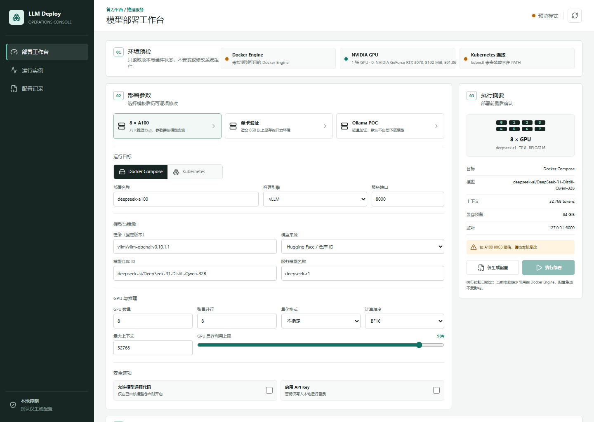
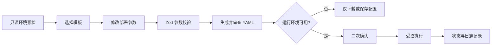

# LLM Deploy Console

一个面向企业内网与算力节点的轻量化大模型部署控制台。它将经过校验的页面参数转换为可审查、可下载、可复现的 Docker Compose 或 Kubernetes 配置，并把“生成配置”和“真实执行”严格分开。

项目重点不是在浏览器里包装几条 Shell 命令，而是展示一套小而完整的运维控制面：环境预检、参数约束、配置生成、执行确认、状态记录、生命周期操作和密钥边界。

**English summary:** A guarded control plane for reviewing LLM deployment parameters and generating reproducible Docker Compose or Kubernetes configuration. It is designed for private AI infrastructure teams that need clear validation, approval, secret handling, and operational boundaries before workloads reach a GPU node or cluster.



> 截图来自本项目在普通 Windows 工作站上的真实运行状态。系统识别到 RTX 3070；Docker 和 kubectl 不可用时，执行按钮会保持锁定。截图没有运行模型、拉取镜像或占用 GPU。

## 适用场景

- GPU 推理节点上线前的参数评审与配置生成
- vLLM 服务的多卡张量并行参数编排
- Ollama 小规模 POC 配置
- Docker Compose 单机部署与 Kubernetes 集群部署
- 国产 GPU 软件栈完成镜像适配后的部署模板扩展
- 面向运维团队的标准化、审计化操作入口原型

## 从控制台到本地算力机房落地

本仓库展示的是部署控制面的可运行原型。真实企业项目还需要把机房、服务器、网络、存储、GPU 软件栈、调度平台、模型服务和持续运营连成一套可以验收的系统。

配套的 [AI 算力机房与私有推理平台落地蓝图](docs/AI-INFRASTRUCTURE-DELIVERY.md) 给出了从需求澄清、IDC 准备度检查、硬件验收、软件栈适配、平台部署、模型服务、监控告警到交接运营的完整工作包。该文档是一份交付方法与验收框架，不把尚未执行的客户环境工作冒充为本仓库已经完成的实测结果。

适合的合作方式包括：

- 海外 AI 产品进入中国时的本地技术准备度评估
- 单节点或小型 GPU 集群的部署验证与运行手册
- 企业自建或托管 AI 机房的供应商协调、上线统筹与验收
- 已有推理平台的稳定性、可观测性、容量和回滚审查
- 中国客户、IDC、硬件厂商与海外研发团队之间的技术接口

## 功能概览

| 能力 | 当前实现 |
| --- | --- |
| 环境预检 | 只读检测 Docker Engine、NVIDIA GPU、kubectl 与集群连通性 |
| 部署模板 | 8 x A100、8GB 单卡验证、Ollama POC |
| 推理引擎 | vLLM、Ollama |
| 参数配置 | GPU 数量、张量并行、量化、精度、上下文、显存比例、端口和模型来源 |
| 配置生成 | 通过 YAML 序列化器生成 Compose 与 Kubernetes manifest |
| 执行控制 | 默认仅预览；运行时可用且二次确认后才允许执行 |
| 生命周期 | Docker/Kubernetes 启动、停止、重启和日志查看 |
| 密钥处理 | Docker 密钥仅进入忽略目录；Kubernetes 引用已有 Secret |
| 本地记录 | 保存部署参数、生成文件、状态和执行结果 |

## 操作流程



浏览器不会直接拼接或执行命令。服务端先用 Zod 校验请求，再从结构化对象生成 YAML；实际执行使用固定命令族与参数数组，不经过 Shell 字符串求值。

## 快速启动

要求 Node.js 20.9 或更新版本。

```bash
git clone https://github.com/hanxiaochi/llm-deploy-console.git
cd llm-deploy-console
npm install
npm run dev
```

打开 `http://localhost:3000`。没有 Docker、kubectl 或可用集群也可以完整体验参数配置和 YAML 预览，真实部署按钮会自动锁定。

## 安全设计

1. **默认不执行**：首次操作只生成配置，不拉取镜像和模型。
2. **环境门禁**：Docker 必须能连接服务端；Kubernetes 必须同时具备 kubectl 和集群连接。
3. **二次确认**：真实执行前展示目标及资源风险，必须再次确认。
4. **输入约束**：部署名、端口、GPU 数量、张量并行和密钥引用均有结构化校验。
5. **命令白名单**：只允许固定的 `docker compose` 与 `kubectl` 操作，不把表单内容交给 Shell 解释。
6. **密钥隔离**：普通部署记录会自动清空 API Key；Docker 密钥只写入被 Git 忽略的 `.env`。
7. **Kubernetes Secret**：manifest 只引用已有 Secret。执行前检查 Secret 是否存在，避免 Pod 因缺少密钥而失败。

控制台不会安装或升级驱动、CUDA、Docker、Kubernetes 和 Python，也不会修改操作系统配置。

## 配置产物

每次点击“仅生成配置”会在本地创建一条部署记录：

```text
runtime/deployments/<deployment-id>/
|-- config.json       # 已脱敏参数
|-- compose.yaml      # Docker Compose 配置
|-- deployment.yaml   # Kubernetes Deployment + Service
|-- status.json       # 状态和更新时间
`-- .env              # 本地密钥，不进入 Git
```

`runtime/` 已加入 `.gitignore`。

## 验证

```bash
npm run lint
npm run build
npm run dev
npm run verify:api
npm audit
```

`verify:api` 会解析生成的 Compose/Kubernetes YAML，检查两种环境变量引用方式、Kubernetes Secret 引用、Service 端口和非法张量并行参数。它不会创建部署记录，也不会调用 Docker、kubectl 或 GPU。

当前版本已在 Windows + NVIDIA RTX 3070 环境完成页面和预览模式验证。真实 8 x A100、国产 GPU 和生产 Kubernetes 集群仍需结合具体硬件、驱动矩阵与集群策略验收。

## 项目结构

```text
src/
|-- app/api/                  # 预检、配置、部署及实例控制 API
|-- components/              # 控制台交互界面
`-- lib/
    |-- deployment-schema.ts  # 参数模型与模板
    |-- generators.ts         # Compose/Kubernetes 生成器
    `-- runtime.ts            # 受控命令与运行记录
scripts/verify-api.mjs        # 无部署副作用的 API 验证
docs/assets/                  # GitHub 文档截图
```

## 生产落地前检查

- 将镜像标签替换为经过扫描和签名校验的固定 digest
- 验证模型、量化格式、驱动、CUDA/CANN 与推理框架兼容矩阵
- 根据 GPU 拓扑和 NVLink/RDMA 情况调整并行策略
- 将示例资源限制、节点标签和存储方式替换为集群策略
- 接入企业 Secret Manager、认证网关、RBAC 和审计系统
- 补充容量压测、TTFT/P99 基线、灰度发布与回滚演练

## 项目边界

这是一个可运行的控制台原型，不声称已经替代成熟的 MLOps 平台。当前版本刻意不加入用户系统、远程 SSH、集群管理员权限、后台任务队列和自动模型下载；这些能力必须在真实的认证、授权、审计及变更管理设计下扩展。

## License

[MIT](LICENSE)
